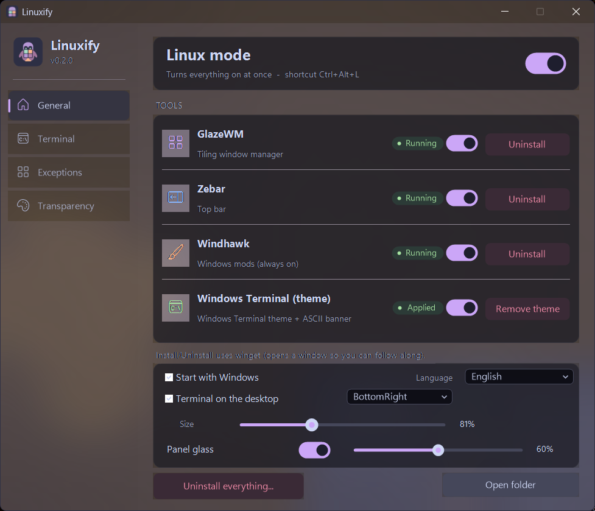
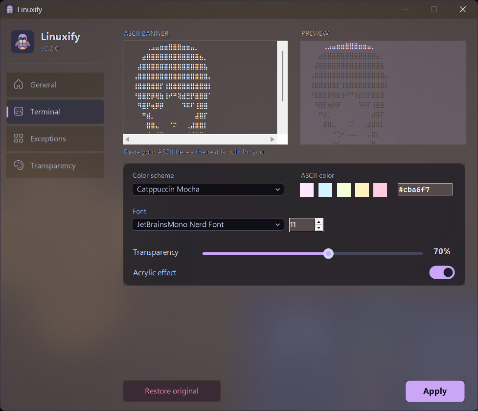
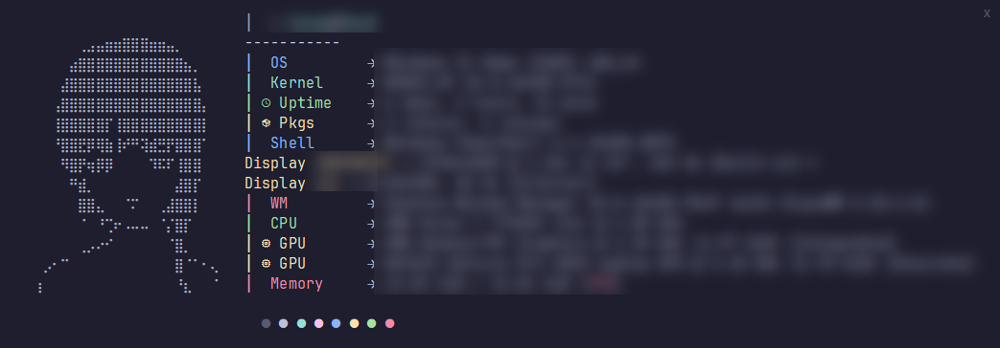

  
  
  
  

<h1 align="center">Linuxify</h1>

<b>Haz que Windows 11 se vea y se sienta como un escritorio Linux con tiling — y actívalo o desactívalo con un clic.</b>

  
  

## ¿Qué es?

Linuxify es una pequeña app de bandeja con un panel moderno que une varias herramientas de código abierto:

- [GlazeWM](https://github.com/glzr-io/glazewm) — gestor de ventanas en mosaico
- [Zebar](https://github.com/glzr-io/zebar) — barra de estado superior
- [Windhawk](https://windhawk.net) — mods de la barra de tareas
- tema Catppuccin Mocha para Windows Terminal, prompt [Starship](https://starship.rs) y banner de [fastfetch](https://github.com/fastfetch-cli/fastfetch)

Todo lo que Linuxify cambia se respalda antes, y el *modo Linux* se puede desactivar en cualquier momento para volver a tu Windows normal.

## Funciones

- **Modo Linux con un clic** — haz clic en el icono de la bandeja (o pulsa **Ctrl+Alt+L**) para iniciar/detener GlazeWM + Zebar y aplicar/quitar el tema de la terminal.
- **Panel moderno** — ventana estilo Windows 11 con cristal acrílico, barra de título oscura, navegación lateral, tarjetas redondeadas, interruptores propios e indicadores de estado. El cristal se puede desactivar o ajustar (*General > Cristal del panel*).
- **Control por herramienta** — activa/desactiva GlazeWM, Zebar, Windhawk y el tema de terminal por separado, e instálalos o desinstálalos con winget desde el panel.
- **Pestaña Terminal** — pega cualquier banner ASCII, elige esquema de colores, color del ASCII, fuente, tamaño, opacidad y acrílico, con vista previa en vivo. *Restaurar original* recupera tu `settings.json` anterior y el logo por defecto.
- **Excepciones de GlazeWM** — elige apps que nunca deben organizarse en mosaico (juegos, launchers, herramientas). Añade por nombre de proceso o desde la lista de ventanas abiertas.
- **Transparencia de ventanas** — haz translúcida cualquier ventana con un control en vivo y guárdalo como regla por app, que se vuelve a aplicar automáticamente.
- **Widget de terminal en el escritorio** — tarjeta opcional de fastfetch fijada al escritorio, con esquina, tamaño (60–120%) y botón de cierre.
- **4 idiomas** — Español, English, Português (BR) y Русский en el panel, menú de bandeja, instalador y desinstalador. Por defecto sigue el idioma de Windows.
- **Seguro** — cada archivo se respalda antes de tocarlo; el desinstalador restaura los originales.

## Requisitos

- Windows 11 (Windows 10 1803+ funciona, con un desenfoque más simple)
- Windows PowerShell 5.1 (incluido)
- [winget](https://learn.microsoft.com/windows/package-manager/winget/) (Instalador de aplicación) para instalar las dependencias automáticamente
- Recomendado: [JetBrainsMono Nerd Font](https://www.nerdfonts.com/) (el instalador puede instalarla)

## Instalación

1. Descarga `Linuxify-vX.Y.Z.zip` desde [Releases](../../releases) y extráelo donde quieras.
2. Haz doble clic en **`Install.cmd`**.
3. Responde **s** para instalar/actualizar las dependencias con winget (GlazeWM, Zebar, Windhawk, fastfetch, Starship y la Nerd Font opcional).

El instalador copia Linuxify a `%LOCALAPPDATA%\Linuxify`, respalda tus configuraciones, escribe las de Linuxify, añade la bandeja al inicio (`HKCU\...\Run`) y la inicia.

Opciones: `install.ps1 -Yes` (sin preguntas), `-NoDeps` (sin winget), `-NoStart` (no inicia la bandeja).

El zip incluye `Linuxify.exe` (la bandeja compilada con ps2exe). Sin él, la bandeja se ejecuta desde `Linuxify.ps1`.

## Uso

| Acción | Cómo |
|---|---|
| Alternar modo Linux | Clic en el icono de la bandeja o **Ctrl+Alt+L** |
| Abrir el panel | Clic derecho en el icono > *Abrir panel...* |
| Cambiar idioma | Panel > *General* > *Idioma* |
| Efecto cristal | Panel > *General* > *Cristal del panel* (interruptor + intensidad) |
| Widget de escritorio | Panel > *General* > *Terminal en el escritorio* |
| Desinstalar | `Uninstall.cmd` o bandeja > *Desinstalar todo...* |

### Pestañas del panel

- **General** — modo Linux, tarjetas de herramientas (estado, on/off, instalar/desinstalar), iniciar con Windows, idioma, widget y cristal.
- **Terminal** — banner ASCII (guardado en `~/.config/fastfetch/logo.txt`), esquema de colores, color del ASCII, fuente, opacidad y acrílico.
- **Excepciones** — apps que GlazeWM ignora. Los juegos encontrados por el scan quedan en la regla `# Jogos (Linuxify)` de `~/.glzr/glazewm/config.yaml`.
- **Transparencia** — opacidad en vivo de cualquier ventana, reglas guardadas por app y "aplicar automáticamente".

## Archivos de configuración

| Archivo | Para qué |
|---|---|
| `%LOCALAPPDATA%\Linuxify\panel.json` | Preferencias del panel (idioma, cristal, color ASCII, banner) |
| `%LOCALAPPDATA%\Linuxify\desktop.json` | Widget de escritorio (activo, esquina, tamaño) |
| `%LOCALAPPDATA%\Linuxify\transparency.json` | Reglas de transparencia por app |
| `%LOCALAPPDATA%\Linuxify\backup\` | Copias de seguridad de todo lo modificado |
| `~/.glzr/glazewm/config.yaml` | Configuración de GlazeWM (mosaico, reglas, excepciones) |
| `~/.config/fastfetch/logo.txt` | Banner ASCII actual (`logo-default.txt` es el predeterminado) |

Las traducciones están en `lang/*.json` (UTF-8). Nuevos idiomas son bienvenidos — copia `lang/en.json`, traduce los valores y abre un PR.

## Desinstalar

Haz doble clic en **`Uninstall.cmd`** (o bandeja > *Desinstalar todo...*). Desactiva el modo Linux, quita el inicio automático y restaura las configuraciones respaldadas. `uninstall.ps1 -RemoveApps` también desinstala los paquetes de winget. Las copias quedan en `%LOCALAPPDATA%\Linuxify\backup` hasta que las borres.

## Solución de problemas

- **Ctrl+Alt+L no hace nada** — otra app usa el atajo; usa el icono de la bandeja.
- **Un juego o app se organiza en mosaico** — añádelo en *Excepciones* o pon el proceso en la regla de juegos.
- **Los iconos salen como cuadrados en la terminal** — instala una Nerd Font y selecciónala en la pestaña *Terminal*.
- **Sin efecto cristal** — requiere Windows 11 (o Windows 10 1803+ para el desenfoque) y los efectos de transparencia activados en Windows; también puedes desactivarlo en *General*.

## Créditos

[GlazeWM](https://github.com/glzr-io/glazewm) y [Zebar](https://github.com/glzr-io/zebar) de glzr.io, [Windhawk](https://windhawk.net) de Ramen Software, [Starship](https://starship.rs), [fastfetch](https://github.com/fastfetch-cli/fastfetch), [Catppuccin](https://catppuccin.com).

## Licencia

MIT — ver [LICENSE](LICENSE).
