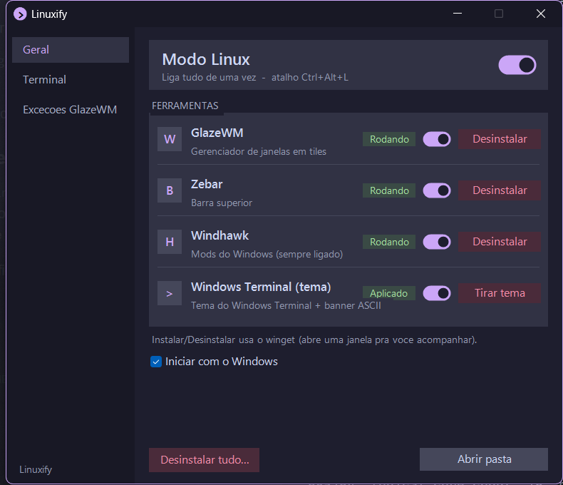
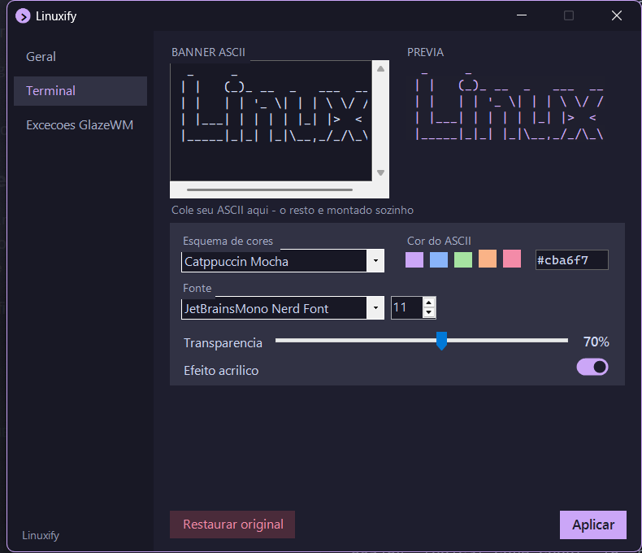

# Linuxify

Make Windows 11 look and feel like a tiling Linux desktop, and switch it all on or off with one click.

Linuxify is a small tray app plus a settings panel that glues together
[GlazeWM](https://github.com/glzr-io/glazewm) (tiling), [Zebar](https://github.com/glzr-io/zebar) (top bar),
[Windhawk](https://windhawk.net) (taskbar mods), a Windows Terminal theme, [Starship](https://starship.rs) and
[fastfetch](https://github.com/fastfetch-cli/fastfetch).

## Features

- **Tray icon**: left-click toggles *Linux mode* (GlazeWM + Zebar + terminal theme). **Ctrl+Alt+L** does the same.
- **Panel** (tray > *Abrir painel...*):
  - **Geral**: per-tool toggles for GlazeWM, Zebar, Windhawk and the terminal theme, plus winget install/uninstall buttons and "start with Windows".
  - **Terminal**: paste any ASCII banner (saved to `~/.config/fastfetch/logo.txt`, used by fastfetch and the desktop widget; *Restaurar original* copies `logo-default.txt` back), pick color scheme, ASCII color, font, opacity and acrylic; live preview; restore the original settings.
  - **Excecoes (GlazeWM)**: apps GlazeWM should not tile (games, launchers...). Add by name or from an open window.
  - **Transparencia**: make any window translucent with a slider and save it as a per-app rule.
- **Terminal na area de trabalho**: optional fastfetch widget pinned to the desktop (Geral tab: toggle, corner and size 60-120%), refreshed every 45 s, with a close button.
- Catppuccin Mocha everywhere.
- Every config it touches is backed up first; uninstall restores the originals.

## Install

1. Download `Linuxify-vX.Y.Z.zip` from [Releases](../../releases) and extract it (the zip includes `Linuxify.exe`, the tray compiled with ps2exe; without it the tray runs from `Linuxify.ps1`).
2. Double-click **`Install.cmd`**.
3. Answer the prompt to install the dependencies with winget (GlazeWM, Zebar, Windhawk, fastfetch, Starship, optional JetBrainsMono Nerd Font).

The installer copies Linuxify to `%LOCALAPPDATA%\Linuxify`, backs up your existing configs, writes the Linuxify
configs, adds the tray to startup (`HKCU\...\Run`) and starts it. Options: `install.ps1 -Yes`, `-NoDeps`, `-NoStart`.

Games: GlazeWM ignores the processes listed under `# Jogos (Linuxify)` in `~/.glzr/glazewm/config.yaml`
(a few common launchers are listed as an example). Add your own games there or in the panel's *Excecoes* tab.

Windhawk: optionally import `configs/windhawk/windows-11-taskbar-styler.json` into the *Windows 11 Taskbar Styler* mod.

## Uninstall

Double-click **`Uninstall.cmd`** (or tray > *Desinstalar tudo...*). It turns Linux mode off, removes startup
entries and restores the backed-up configs. `uninstall.ps1 -RemoveApps` also uninstalls the winget packages.

## PT-BR

Baixe o zip em Releases, extraia e clique duas vezes em `Install.cmd`. O icone na bandeja liga/desliga o modo Linux
(ou Ctrl+Alt+L) e o painel tem as abas Geral, Terminal, Excecoes e Transparencia. Para remover, use `Uninstall.cmd`.

## Credits

[GlazeWM](https://github.com/glzr-io/glazewm) and [Zebar](https://github.com/glzr-io/zebar) by glzr.io,
[Windhawk](https://windhawk.net) by Ramen Software, [Starship](https://starship.rs),
[fastfetch](https://github.com/fastfetch-cli/fastfetch), [Catppuccin](https://catppuccin.com).

## License

MIT, see [LICENSE](LICENSE).
